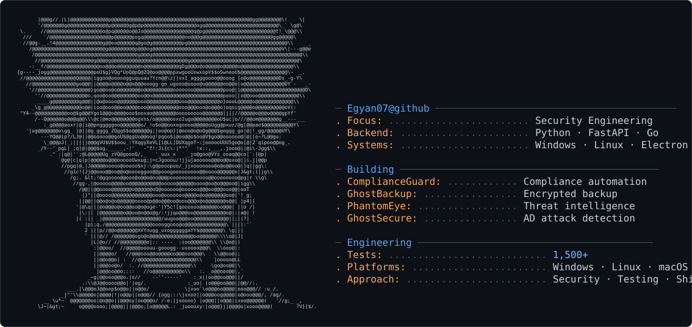

<picture>
  <source media="(prefers-color-scheme: dark)" srcset="dark_mode.svg" />
  <source media="(prefers-color-scheme: light)" srcset="light_mode.svg" />
  
</picture>

<div align="center">

<a href="https://github.com/Egyan07">
  
</a>

<br/>

[](https://github.com/Egyan07)

<br/>


&nbsp;
[](https://github.com/Egyan07?tab=followers)
&nbsp;

&nbsp;

&nbsp;


</div>

---


### About Me

I design, build, test, secure, and ship production-grade security tools, automation platforms, and commercial SaaS products — entirely self-directed, without a formal engineering mandate.

By day I work in **IT & Self-Assessment** at **Red Parrot Accounting** (UK). In practice I've shipped 10+ tools that didn't exist before I built them: from SOC 2 compliance automation to Active Directory attack detection, TLS fingerprinting, threat intelligence platforms, and encrypted backup systems.

My degree is in **Business Management**, not CS — everything technical is self-taught. I approach security from both sides: I build the attack demo *and* the detector. I write 1,600+ tests because untested code is unmaintainable code. Every dependency is a supply chain decision.

- **Built 6+ security tools** covering AD, TLS, IOCs, backups, and compliance
- **90% backend test coverage** on GhostBackup (744+ tests)
- **Zero-dependency architecture** wherever the stdlib is sufficient
- **Documents limitations honestly** — before you find out yourself

<br clear="right"/>

---

## Stats & Activity

<div align="center">

[](https://github.com/Egyan07)

<br/>

[](https://github.com/Egyan07)

<br/>

[](https://github.com/Egyan07)

</div>

## Tech Stack

<div align="center">

**Languages**


<br/>

**Backend & Infrastructure**


**Frontend & Desktop**


**Security & Testing**


</div>

---

## Featured Projects

### 🔐 Security & Compliance

| | |
|---|---|
| **[ComplianceGuard](https://github.com/Egyan07/complianceguard)** v3.1.0<br/>SOC 2 automation platform. Scores against 29 controls, PDF reports, Ed25519 licensing. 311+ tests.<br/>`FastAPI` `React` `Electron` `PostgreSQL` | **[GhostBackup](https://github.com/Egyan07/GhostBackup)** v4.1.0<br/>Military-grade AES-256-GCM streaming encryption. 744+ tests, 90% coverage, delta detection, 7-year retention.<br/>`Python` `FastAPI` `Electron` `SQLite` |
| **[PhantomEye](https://github.com/Egyan07/PhantomEye)** v2.1<br/>Zero-dependency threat intelligence. 40,000+ IOC indicators, O(1) lookup, firewall log scanning. 222+ tests.<br/>`Python` `SQLite` `CodeQL SAST` | **[GhostSecure](https://github.com/Egyan07/GhostSecure)** v3.0.0<br/>Real-time Active Directory attack detection. 7 detectors: Kerberoasting, Pass-the-Hash, DCSync, Golden Ticket.<br/>`Python` `pywin32` `Windows Service` |

### 🔗 Network & Cryptography

| | |
|---|---|
| **[ViperFin](https://github.com/Egyan07/ViperFin)** v1.5<br/>JA3/JA3S TLS fingerprinting in pure Go. 22-signature threat database: Cobalt Strike, Emotet, TrickBot. RFC 8701 GREASE filtering.<br/>`Go` `TLS` `Cross-platform` | **[VaultSentry](https://github.com/Egyan07/VaultSentry)** v2.0.1<br/>Backup integrity monitoring. SHA-256 hashing, Shannon entropy ransomware detection, snapshot diffing, restore engine.<br/>`Python` `SQLite` `Tkinter` |

### 💼 Production Platforms

| | |
|---|---|
| **Accounting Automation Platform** (Red Parrot Accounting, UK)<br/>AI-powered bank statement converter (PDF→Excel), HMRC letter interpreter, holiday tracker with approval workflows, ops dashboard. Live in production, 50+ users.<br/>`React 18` `Supabase` `Claude API` `TypeScript` `shadcn/ui` | **Active Directory Forensics Suite** (Internal)<br/>Windows Service + CLI tooling for post-breach AD analysis. Recovers deleted accounts, logs, and privilege escalation paths.<br/>`Python` `PowerShell` `Windows Registry` |

---

## Engineering Metrics

<div align="center">

| | | | |
|:---:|:---:|:---:|:---:|
|  |  |  |  |

</div>

---

## Philosophy

```python
class SecurityEngineer:
    def __init__(self):
        self.tests      = "if it's not tested, it's not done"
        self.docs       = "document limitations before users find them"
        self.security   = "build the attack to understand the defense"
        self.execution  = "don't wait for a mandate — identify the risk, ship the fix"
        self.deps       = "stdlib first; every dependency is a supply chain decision"
        self.shipping   = "perfect is the enemy of shipped"
```

---

## Currently Exploring

- **Hardening Electron apps** against modern attack surfaces (process isolation, CSP, update signing, sandbox escapes)
- **Offline-first cryptographic licensing** systems that don't phone home
- **Porting Windows security tools** to macOS and Linux without losing native depth
- **Open-core SaaS pricing models** for security tooling — where the line between free and paid sits
- **EDR/XDR evasion research** — how defenders detect the techniques I build

---

## Open to Collaboration

💡 **Building something in security?** I'm interested in:
- Backend architecture for high-throughput security platforms
- Cryptographic systems design (licensing, key derivation, encryption)
- Cross-platform tooling (especially bringing Windows-first tools to macOS/Linux)
- Test-driven security development

<div align="center">


**Let's build secure systems that actually ship.**

[](https://github.com/Egyan07)
&nbsp;
[](mailto:alexisegyan1232@gmail.com)
&nbsp;
[](https://linkedin.com/in/egyan07)

</div>

<div align="center">


</div>
